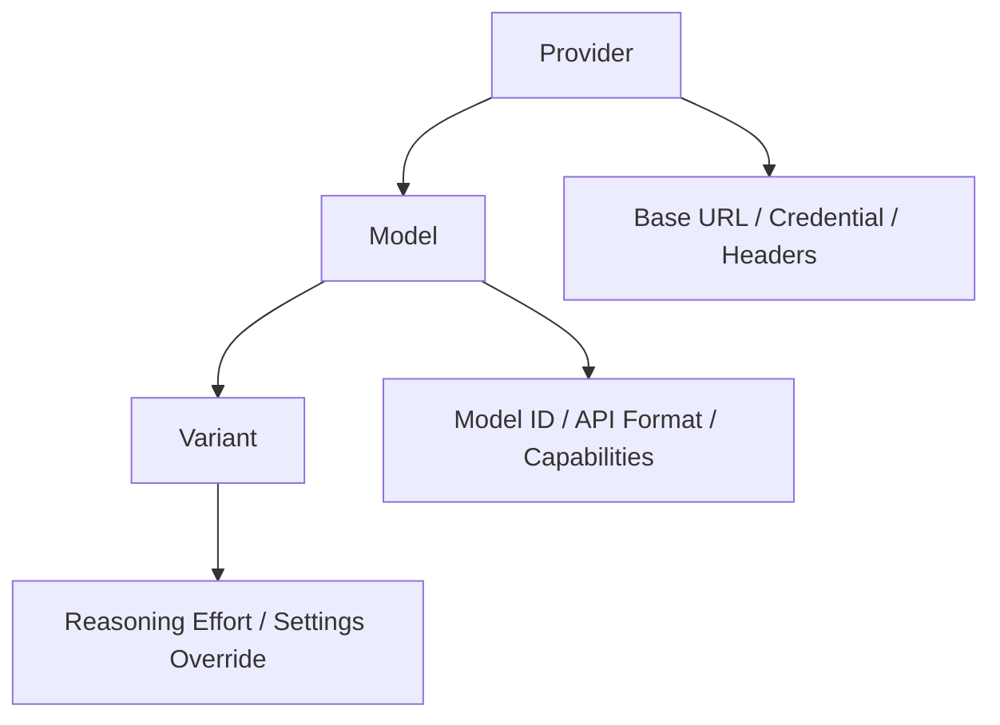
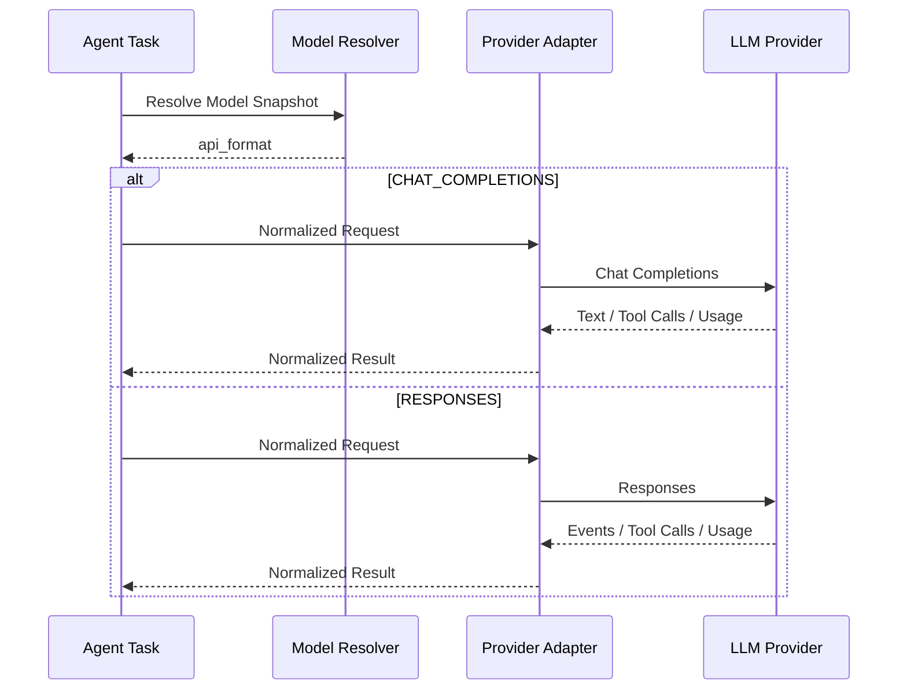
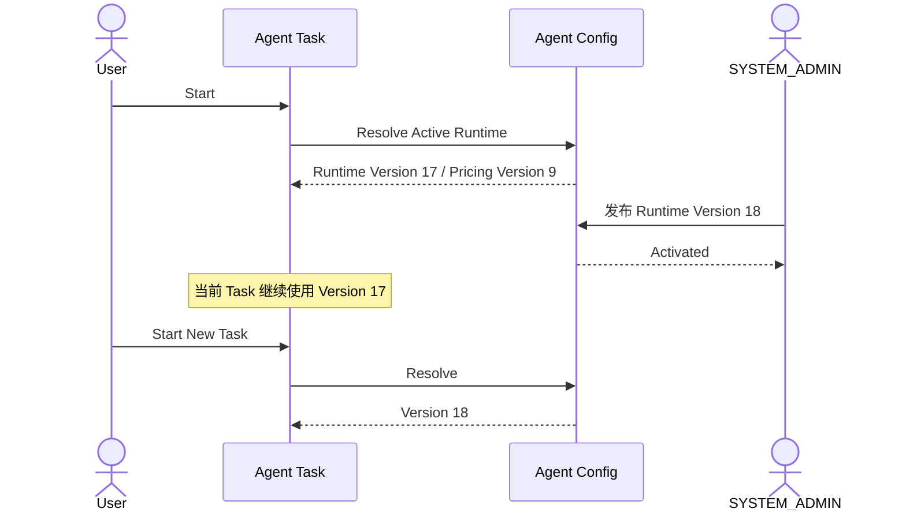
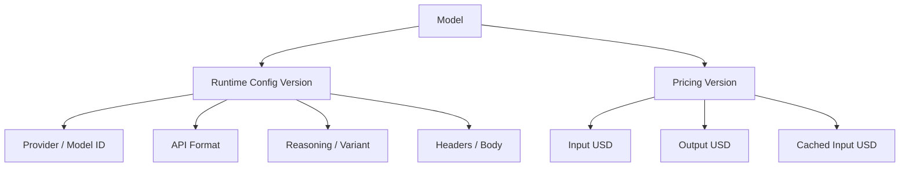
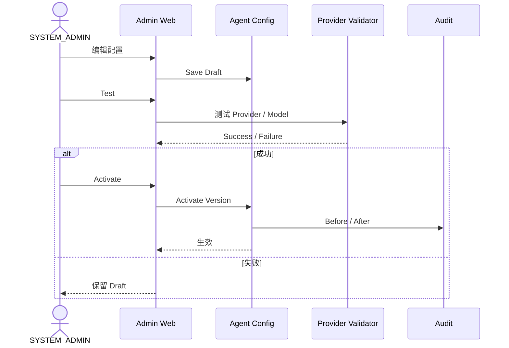

# 2026-10-31 生效产品决策：三档主备模型、原生协议与人民币积分

> **本章为当前现行决策，优先于下方历史初稿中“只有两种协议、Variant 仅映射一个模型、管理员可配置 USD→Points 比例”等旧表述。** 下方原 1～9 节作为历史设计基础保留，实施时按本章和模块 01 积分账户的最新补充执行。状态：核心产品语义已确认，少量汇率/默认档位等配置细节待确认。

## A. 用户侧仅三个档位

- 普通用户（OWNER/获准使用 Agent 的 STAFF）在 Android、iOS、Web、微信小程序中只看到 **快速 FAST / 标准 STANDARD / 深入 DEEP**。用户可以选择档位，但不能看到/选择 Provider、Model ID、备用模型、Key、Base URL、真实 Thinking 或上下文参数。
- 仅 SYSTEM_ADMIN 在专属后台管理真实 Provider、一个 Provider 下多个 Model、模型启停、三档主备、各自推理强度和上下文/输出限制、API 协议、定价以及配置发布。普通用户不可自定义服务供应商。
- 每个档位分别配置 **一个 Primary 主模型 + 一个 Backup 备用模型**；后台的三个档位不代表三个固定的物理模型。同一个 Model 也可以在不同档位引用不同运行参数。
- 三个档位不等于固定 LOW/MEDIUM/HIGH：每个主/备模型的 Reasoning、Thinking/Effort 参数按实际 Provider 能力配置，不支持的参数不发送。
- 完整经营 Agent 选用的模型和对应 Adapter 必须支持 **Tool Calling、流式输出、结构化输出、明确的上下文限制、输出限制**；组合使用能力须匹配，不能仅凭模型名宣称支持。

~~~mermaid
flowchart TD
    SA[管理员维护多个 Provider 与 Model] --> R[三个档位路由配置]
    R --> F[FAST 主模型 + 备用模型]
    R --> S[STANDARD 主模型 + 备用模型]
    R --> D[DEEP 主模型 + 备用模型]
    U[普通用户仅选择快速 标准 深入] --> T[Agent Task]
    F --> SNAP[路由配置快照]
    S --> SNAP
    D --> SNAP
    T --> SNAP
    SNAP --> CALL[根据当前档位调用主模型或备用模型]
    CALL --> LOG[记录真实模型及实际费用]
~~~

**图示说明：** 管理员发布版本化的完整三档配置；Task 开始时保存当时档位的主备配置快照。任务执行期间允许使用这个快照中预先指定的备用模型，这不属于运行中擅自变更配置版本。用户只感知档位，不暴露后台模型详情。

## B. Provider / Model / Protocol / Variant 管理

| 配置对象 | 管理员管理的事实 |
|---|---|
| Provider | 内部 provider_key、启用状态、系统支持的协议 Adapter、API Base URL、凭据引用、Headers |
| Model | 一个 Provider 下多个 model_key；实际 provider model_id、启停、上下文和最大输出 Token、支持的功能 |
| Model 能力 | Tool Calling、Streaming、Structured Output、Thinking、Reasoning 参数及组合兼容范围 |
| Tier Route | FAST / STANDARD / DEEP 各自 Primary / Backup，允许经管理员授权的不同 Provider、不同 Model |
| 每个主/备的参数 | Reasoning/Thinking/Effort、Context Limit、Output Limit 等模型真实支持的参数 |
| 定价 | 官方价格来源、生效时间、官方币种、单位、不同 Token 与额外官方计费项目、pricing_version |
| 管理动作 | 新增/更新系统支持的 Provider 与 Model、启停、必要的连接/能力检查、发布 route/runtime/pricing 新版本 |

**协议支持范围：**

| API Format | 设计状态 | 差异 |
|---|---|---|
| CHAT_COMPLETIONS | 既有正式设计 | messages、tool_calls、delta |
| RESPONSES | 既有正式设计 | response items、流式 Tool Calls、reasoning.effort |
| ANTHROPIC_MESSAGES | 本轮纳入后端 Adapter 设计范围 | tool_use、tool_result、thinking/effort、缓存读写 |
| GEMINI_INTERACTIONS | 本轮纳入后端 Adapter 设计范围 | step events、function_call、thinking、Usage |
| GEMINI_GENERATE_CONTENT | 兼容需求候选；是否与 Interactions 同时实现待定 | 原生 GenerateContent 函数调用与事件格式 |

**说明：** 多种协议纳入系统设计，不等于其后端 Adapter 已经实现。管理员只能在代码真正支持的协议/Provider 中选用，不能直接上传任意协议脚本或让普通用户填入自定义接口。统一 Adapter 向 Agent Runtime 返回文本增量、完整工具调用、Finish Reason、Usage 和内部错误；流式工具参数完整解析后才能执行真实业务 Tool。

官方参考：OpenAI Responses Reasoning https://developers.openai.com/api/docs/guides/reasoning；Anthropic Messages https://platform.claude.com/docs/en/agents-and-tools/tool-use/how-tool-use-works；Gemini Interactions https://ai.google.dev/gemini-api/docs/interactions-overview。

## C. 主备故障切换

~~~mermaid
flowchart TD
    A[Task 读取已锁定档位的主备快照] --> B[请求 Primary]
    B --> C{请求结果}
    C -->|成功| OK[继续 Agent Task]
    C -->|临时故障且当前调用可安全重试| BK[尝试 Backup]
    C -->|不能安全重试| FAIL[保存任务状态与内部错误]
    BK --> K{备用可用吗}
    K -->|是| OK
    K -->|否| FAIL
    FAIL --> MSG[向用户返回简短友好的暂不可用提示]
    OK --> USAGE[记录真实模型和 Usage]
    MSG --> USAGE
~~~

**说明：** 429/5xx/服务临时不可用等可触发备份尝试，具体仍需判断当前 Model Call 是否可安全重试。普通用户看到的是“模型暂时故障，请稍后重试”或“当前使用高峰，暂时不可用”；内部保留真实错误类型。

- **不从 Task 起点重放已成功工具调用**，更不能重复库存调整、销售出库、采购草稿创建；Tool Call 的已提交业务事实、幂等与恢复由 06/07 模块处理。
- 已流式发出一段正文时，替换模型可能导致重复、不连贯文本，不能把新旧内容无标识拼接；交由 12 流式事件模块设计“已中断/重新生成”表现。
- 权限拒绝、非法参数、Provider 配置问题、余额准入不足、备用上下文容量不足不应被无脑重试掩盖；对“不可用”的处理须区分可安全备用和需要向用户报告的情形。
- 某次主模型虽失败但有 Provider 真实已收费 Usage，应与备用成功调用分别计费；每个尝试记录实际 Provider/Model/价格版本/Usage。
- Task 的“已准入完成权”禁止因余额下降中断，不保证第三方 Provider 永远可用。主备全部故障时任务可以合法进入失败或可恢复状态。

## D. 按实际模型官方价格计费，积分与人民币 1:1

**本轮明确：1 积分 = 1 人民币元。**

~~~mermaid
flowchart TD
    U[实际 Model Call 与真实 Usage] --> P[对应 Provider Model 的官方费率版本]
    P --> ORIG[原始币种费用]
    ORIG --> FX{费率币种}
    FX -->|CNY| RMB[人民币费用]
    FX -->|USD及其他| CONV[依版本化汇率折算人民币]
    CONV --> RMB
    RMB --> PTS[积分数量与人民币金额 1比1]
    PTS --> TASK[Task 汇总]
    TASK --> ACCOUNT[模块01 Merchant 积分账户最终结算]
~~~

**说明：** 用户选“标准”不代表固定费用；若主模型故障而备用模型执行成功，各次真实调用依其各自官方费率计算。模型费用事实由 Agent 产生，余额/流水/扣减仍由账户模块负责。

- 使用实际供应商 Usage 和模型官方计价；区分未缓存输入、缓存读取、缓存写入、输出（有些官方把思考 Token 纳入输出收费）、长上下文分档、特殊服务级别或官方额外收费。不能双算已包含于输入总量中的缓存命中 Token。
- 官方价格可由管理员维护具备来源和生效时间的版本；价格更改后历史模型调用与 Task 账单不重算。
- 以美元报价的模型先记录真实 USD 费用，再折算成 CNY；原本以人民币计价则直接使用 CNY。**USD/CNY 汇率来源、采用时点和精度未确认**，不得凭空假设 1 USD = 1 RMB；只有 Points/CNY 的比率固定为 1:1。
- 按 Provider 实际 Usage 记录。Usage 不可得时记录费用待确定，不能虚构 Token；保留原结算待处理状态 SETTLEMENT_PENDING 与最终结算幂等规则。
- 使用 Decimal/fixed-point 算钱；积分最小精度与 rounding 在账户模块对接时确定。不要因模型请求失败就无条件判定费用为零。

## E. 与旧方案衔接

- 历史原设计的 Provider → Model → Variant、内部 Model Key 与外部 Model ID 分离、Runtime 与 Pricing 独立版本化、Chat Completions/Responses Adapter、Model Call Usage 日志仍有价值。
- **三档主备路由是新的正式业务约定**；历史将 Variant 简单等同为三个 Reasoning 值的示例不能再当成产品规则。
- 历史“Task 已开始不切模型配置”应按**不修改 Task 已固定的主备配置快照**理解，允许快照内 Primary→Backup。
- 历史“USD→Points 比例由管理员配置”被本轮更改为 **按官方计价币种→人民币→固定 1:1 积分**，需以账户模块本轮新补充为准。
- 各业务 Tool 的真实写入仍通过正常 Application Service；不让模型直接调用任意 SQL。
- 用户切换档位什么时候对当前 Task 生效、初始默认档位（建议 STANDARD）、官方汇率来源与锁定时点、积分小数精度、特殊计费明细，继续做定点讨论，不能擅自冻结。

---

# 历史基础设计（2026-10-31 之前的版本，以上现行决策优先）


# 10.1 — 模型提供商与模型配置详细设计

# 1. SYSTEM_ADMIN 管理范围

SYSTEM_ADMIN 可以配置：

```text
Provider
Base URL
Credential Reference
Headers
默认 API Format
Model
Model ID
Model Enable / Disable
Context Limit
Output Limit
Tool Capability
Reasoning Effort
Variant
Input Token USD Price
Output Token USD Price
Cached Input USD Price
```

# 2. Provider → Model → Variant



**图示说明（2. Provider → Model → Variant）：** 这是责任或数据流图，核心节点包括 Provider。箭头表示调用、归属或数据流向；权限、Merchant 范围和状态判断必须在服务端完成，不能由客户端或单一 UI 分支替代。

覆盖优先级：

```text
Variant > Model > Provider
```

# 3. 两种 API Format

正式支持：

```text
CHAT_COMPLETIONS
RESPONSES
```



**图示说明（3. 两种 API Format）：** 这是服务调用时序图，参与者包括 Agent Task、Model Resolver、Provider Adapter、LLM Provider。箭头表示一次调用或返回，alt/else 分支表示 Decision 的不同结果；事务提交前只做校验和状态准备，短信、邮件等外部副作用应在提交后通过 Outbox 执行。

# 4. Model ID 与系统内部 Model Key 分离

```text
model_key
= 系统内部稳定标识

model_id
= 实际发送给 Provider 的模型 ID
```

管理员修改真实模型 ID 时，不需要修改业务代码。

# 5. Reasoning / Variant

统一候选可以包括：

```text
NONE
MINIMAL
LOW
MEDIUM
HIGH
XHIGH
```

但每个模型只启用真实支持的集合。

例如：

```text
fast     → LOW
standard → MEDIUM
deep     → HIGH
```

# 6. 运行配置版本化

SYSTEM_ADMIN 可以随时修改配置，但已开始 Task 不允许中途切模型配置。



**图示说明（6. 运行配置版本化）：** 这是服务调用时序图，参与者包括 User、Agent Task、Agent Config、SYSTEM_ADMIN。箭头表示一次调用或返回，alt/else 分支表示 Decision 的不同结果；事务提交前只做校验和状态准备，短信、邮件等外部副作用应在提交后通过 Outbox 执行。

# 7. Runtime 与 Pricing 分开版本化



**图示说明（7. Runtime 与 Pricing 分开版本化）：** 这是责任或数据流图，核心节点包括 Model。箭头表示调用、归属或数据流向；权限、Merchant 范围和状态判断必须在服务端完成，不能由客户端或单一 UI 分支替代。

# 8. Model Call Usage

每次 Model Call 至少能够追踪：

```text
task_id
call_seq
provider
model_key
model_id
runtime_config_version
variant
api_format
reasoning_effort
input_tokens
output_tokens
cached_input_tokens
pricing_version
input_usd
output_usd
cached_input_usd
total_usd
status
```

Agent Task 完成后：

```text
Σ Model Call USD Cost
= Task Total USD
```

再交给账户模块进行积分结算。

# 9. 配置发布

建议：

```text
Draft
→ Test
→ Activate
→ Rollback
```



**图示说明（9. 配置发布）：** 这是服务调用时序图，参与者包括 SYSTEM_ADMIN、Admin Web、Agent Config、Provider Validator。箭头表示一次调用或返回，alt/else 分支表示 Decision 的不同结果；事务提交前只做校验和状态准备，短信、邮件等外部副作用应在提交后通过 Outbox 执行。
